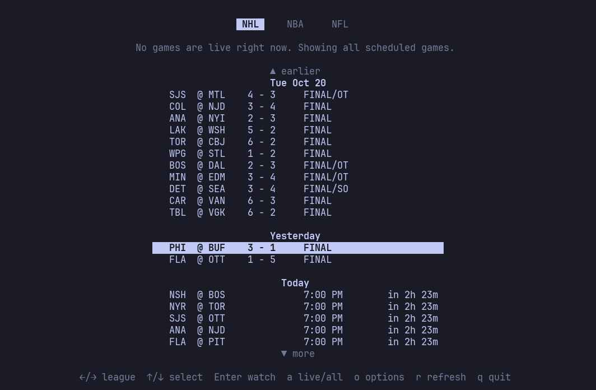
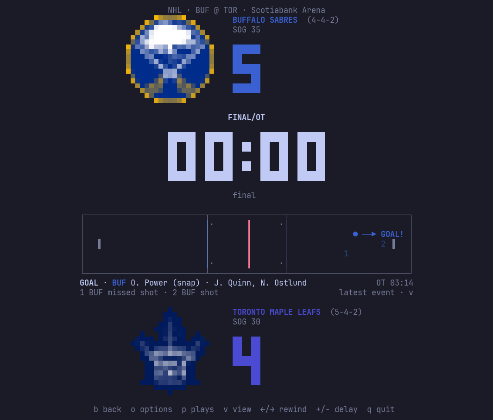
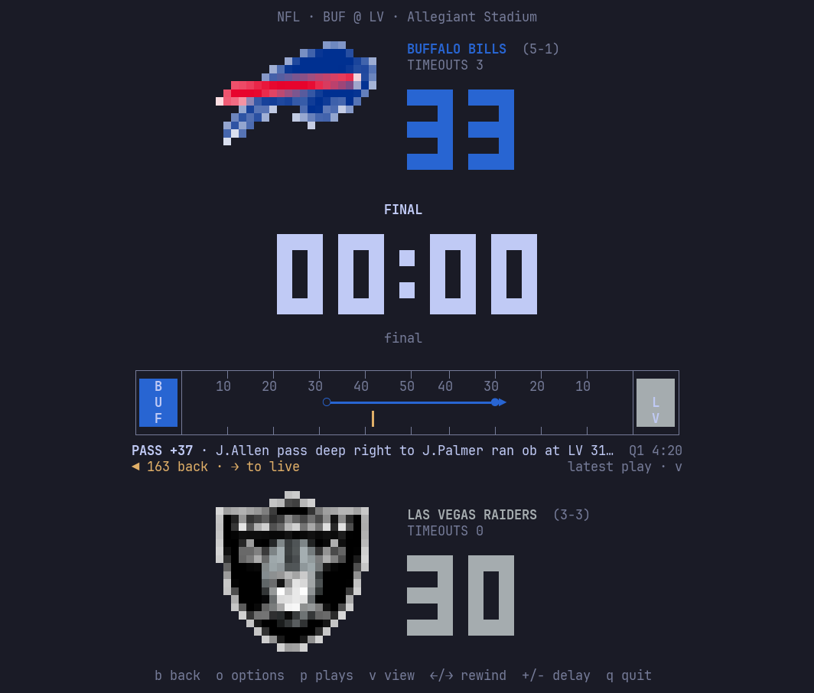
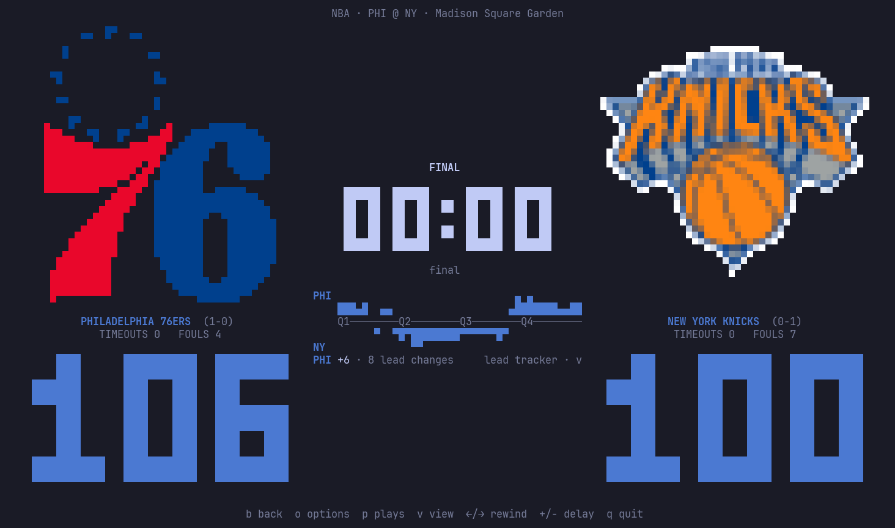
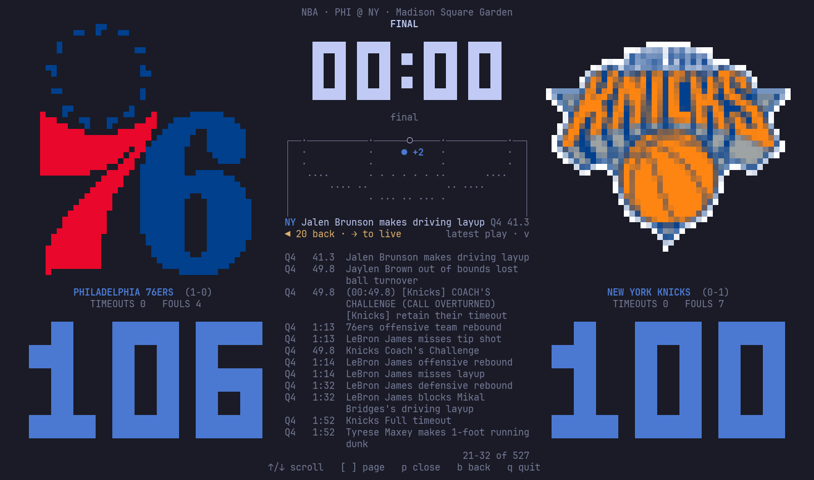

# scoreboard

Live NHL, NBA and NFL scores in the terminal: the week's games by day, a game view with logos, a big clock
and a play-by-play picture, and a stream delay that keeps it all in step with a TV or stream that's behind.
Python 3.10 or newer, standard library only.

| Game list: the week by day, earlier days loaded with `↑` | NHL: the latest event, a Sabres overtime winner |
|---|---|
|  |  |
| **NFL: back with `←` to a Bills pass, snap to catch** | **NBA: side by side, with the lead tracker** |
|  |  |

The play list (`p`) under the play-by-play view, both gone back to a Knicks basket:

## Running it

    git clone https://github.com/log-ical/scoreboard-cli.git
    scoreboard-cli/bin/scoreboard

There's nothing to install. To run it as `scoreboard` from anywhere, link the launcher onto your `PATH`:

    ln -s "$PWD/scoreboard-cli/bin/scoreboard" ~/.local/bin/scoreboard

Then:

    scoreboard              # opens the league you used last
    scoreboard nba          # or: nhl | nfl
    scoreboard --delay 45   # stream delay in seconds (saved)
    scoreboard --color 256  # force a color mode: truecolor | 256 | 16
    scoreboard --symbols console   # force a symbol set: full | console | ascii

## Keys

| Screen    | Keys |
|-----------|------|
| Game list | `←/→` or `1/2/3` league · `↑/↓` move (`↑` at the top: earlier games), `PgUp/PgDn` `Home/End` · `Enter` watch · `a` live/all · `o` options · `r` refresh · `q` quit |
| Game view | `p` expand/collapse the play list (`↑/↓` scroll, `[`/`]` or `PgUp/PgDn` page) · `v` next play-by-play view · `←/→` step back and forth through its events (`[`/`]` score to score with the play list closed, `Home`/`End` first and latest) · `+`/`-` adjust delay · `o` options · `b`/`Esc` back · `q` quit |
| Options   | `↑/↓` choose · `←/→` change · `o`/`Esc` close |

`Ctrl-L` repaints the screen if anything ever looks garbled.

## The game view

The away team is on top and the home team on the bottom, each centered in its half, with the period and
clock in the middle. Before a game starts the big clock counts down to the scheduled start (`1:04:59`, or
`2D 03:15` for days, hours and minutes). With **Logo layout** set to horizontal, the teams sit side by side
(away left, home right) with the clock between them; windows too narrow for that use the vertical layout.
Logos are fitted into a box that is square on screen, using the terminal's cell size in pixels when it
reports one, so tall and wide logos come out the same size.

The play-by-play view (on in **Options**) draws the latest event where it happened, with what it was:

- **NHL**: shots and the save, goals, hits, faceoffs, takeaways and penalties on the rink, a shot's arrow
  pointing at the net it went at, and the two events before it numbered.
- **NBA**: shots, rebounds, fouls and turnovers on a half court, with the score after.
- **NFL**: the play from the snap to where the ball ended up, with the yards and the down after.

`v` switches to the other styles: a period's shot map or a zone strip for the NHL, a lead tracker or a shot
chart for the NBA, a yard bar or the full field (ball, drive direction and first-down line) for the NFL.
The style is remembered per league. `←/→` go back through the game's events, and each view then shows the
game as it stood (the maps, that event's period); `→` past the latest is live again. It needs about a
40-row window in the vertical layout.

Press `p` to expand the last-play line into a scrollable list of earlier plays, newest first (in the
horizontal layout it fills the space between the teams, which stay put): every goal and penalty for the
NHL; for the NBA and NFL, the newest 25-50 plays, with older pages loaded as you page past them (`]`).

With a stream delay, nothing past the play the delayed view is on shows anywhere in the game view: the
play list and the play-by-play view stop there, and season records are hidden while the delayed view is
behind a game that has already ended.

## The game list

The NHL and NBA lists cover the week (the league's current day plus the six after it) and the NFL the ESPN
week; each day gets a heading, and the list scrolls. Days ahead are refetched every 10 minutes. Games
starting within a day show a countdown (`in 2h 05m`), and a red ● on a league tab means it has live games.

Pressing `↑` on the first game (under the `▲ earlier` marker) loads the last day before it that had games;
keep pressing to go further back (up to two weeks between game days). With games live, the first `↑`
switches to all games. Earlier days stay loaded until you quit: switching leagues hides them again, and `↑`
brings them back without reloading. Coming back from a game selects it again. A list starts on the first
live game, or else the next one to be played, so late at night last night's finals don't come first.

## Options

Saved to `~/.config/scoreboard/settings.json`. A file the app can't use (a typo, a value it doesn't know)
is kept as `settings.json.bad`, with a warning, rather than saved over.

- **Stream delay** (off to 30 min): the game view lags real time to match a delayed TV or stream.
- **Hide scores in game list**: the list is always real time, so this makes it spoiler-free (live games
  show just `LIVE`: a period or clock would give away which went to overtime).
- **Flash on scores** / **Beep on scores**: NHL goals and NFL scores, on the delayed view.
- **Show last play**: NHL last goal and assists; NBA and NFL latest play.
- **Show team stats**: NHL shots on goal; NBA timeouts and team fouls; NFL timeouts.
- **Show game situation**: NHL power play and empty net; NBA bonus; NFL possession, red zone, down and distance.
- **Show season records**: next to each team name (NHL W-L-OTL from the standings).
- **Play-by-play view**: see [The game view](#the-game-view).
- **Symbols**: auto picks console-safe symbols on the Linux text console (`TERM=linux`), whose fonts draw
  many symbols alike (`◦` and `●`), ASCII when the terminal has no Unicode, and full Unicode elsewhere.
- **Logo size**, **Logo layout** (vertical or horizontal), **Color mode**, **24-hour start times**

## Data and the clock

The scores come from the NHL's and ESPN's public web APIs. They're unofficial and undocumented, so they can
change without notice.

| League | Source | Updates |
|--------|--------|---------|
| NHL | `api-web.nhle.com` | Cached about 19 s. Polled right after each cache expiry, with the `Age` header giving each update's real time. The API says whether the clock is running. |
| NBA, NFL | ESPN (`site.api.espn.com` for lists, `sports.core.api.espn.com` while watching) | About 3 KB per poll, every 3 s (NBA) or 5 s (NFL). ESPN doesn't say whether the clock is running, so it's inferred from the last play's type (timeout, foul, incomplete pass, ...) and timed from that play's timestamp. |

Between updates the clock runs locally, absorbing small corrections smoothly. Stoppages show up only
when the data reports them, so the clock can briefly run past a whistle and then jump back. If no update
comes in for a minute, the game view's title says so.

Logos come from ESPN's CDN and are cached in `~/.cache/scoreboard/logos/`. The play-by-play view adds one
request per NHL poll (the play-by-play feed, ~11 KB) and one per NBA or NFL game (all its plays,
~40-100 KB), only while it's on. ESPN's play list is only downloaded while it's open.

## Development

    bin/scoreboard          launcher (works through a symlink)
    scoreboard/
      app.py                argument parsing, screen loop
      screens.py            game list and game view
      model.py              league-neutral Game/Team/Event model, stale-update filter
      clock.py              local clock running and smoothing
      settings.py           settings file and options menu
      live.py               the play-by-play views
      leagues/              one adapter per data source
        nhl.py              NHL web API
        espn.py             NBA and NFL (ESPN), clock-stop rules per sport
      logos.py png.py       logo download and cache; PNG decoder
      render.py term.py     block font and half-block logos; terminal I/O and colors
      net.py                HTTP and cache-age helpers
    tests/                  unittest suite with captured API responses in fixtures/

Run the tests with `python3 -m unittest discover -s tests -t .` from the top of the repo. CI runs them on
Python 3.10 and 3.14.

To add a league, write an adapter with `list_games()`, `open(game)` (returns a poller whose `poll()` gives
`(Game, data_time, seconds_until_next_poll)`) and `score_alert(points)`, then register it in `leagues/__init__.py`.
